# Diffusion Models from Scratch: a Hands-On Report

This repository is a learning path through diffusion models, built up one project at a time in a
single small PyTorch codebase. It runs on the GWDG Grete cluster with A100 GPUs. Each stage adds one
idea on top of the previous one:

> toy 2D data → images → faster samplers → guidance → flow matching → latent diffusion →
> transformers → Stable Diffusion → distillation

Every experiment is trained and evaluated with Slurm jobs. All numbers below come from those runs.

**FID** (Fréchet Inception Distance, lower is better) is computed on **5,000 samples** against the
training set. It is comparable *within* this report, but papers use 50k samples and therefore report
lower values.

## Contents

| Stage | Project | Script | Headline result |
|---|---|---|---|
| 1.1 | DDPM on 2D toy data | `ddpm_2d_Sg1_1.py` | spiral learned, Chamfer 0.037 |
| 1.2 | DDPM on images | `ddpm_images_Sg1_2.py` | MNIST FID **4.7**, CIFAR-10 FID **23.9** |
| 2.1 | Samplers: DDIM, Euler, Heun | `samplers_Sg2_1.py` | Heun FID 27 with 99 model calls |
| 2.2 | Classifier-free guidance | `cfg_Sg2_2.py` | CIFAR-10 FID 35.7 → **21.8** at w = 2 |
| 2.3 | Flow matching | same scripts, `--method flow` | CIFAR-10 FID **25.5** |
| 3.1 | Latent diffusion on CelebA 128² | `latent_Sg3_1.py` | FID 36.9 (pixel) → **12.5** (latent) |
| 3.2 | Diffusion Transformer (DiT) | `latent_Sg3_1.py --arch dit` | DiT-S/2 FID **13.0** |
| 3.3 | Taking apart Stable Diffusion 1.5 | `sd_Sg3_3.py` | own sampler, CFG, img2img, inpainting, LoRA |
| 4.1 | Progressive distillation | `distill_Sg4_1.py` | **4 steps: FID 29** (DDIM: 125) |

---

## Stage 1.1: DDPM on 2D toy data

**Goal.** Understand the DDPM forward process (adding Gaussian noise over T = 1000 steps) and the
reverse process (a network predicts the noise, which is removed step by step) on data small enough
to see completely: 2D points on a spiral.

**Setup.**
- Model: an MLP with a sinusoidal time embedding.
- Loss: MSE between the true and the predicted noise.
- Evaluation: Chamfer distance between generated and real point clouds.


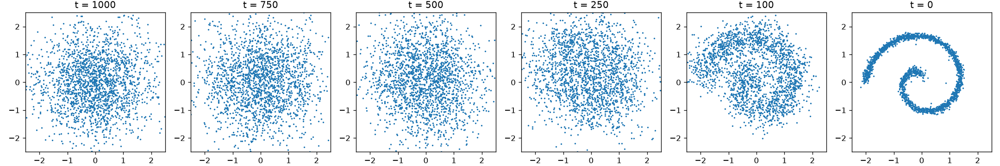

*Reverse process: pure Gaussian noise (left) gradually contracts onto the spiral (right).*

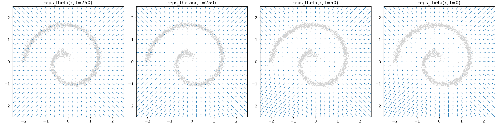

*The learned denoising direction at different noise levels. Every arrow points back towards the data.*

**Result.** Chamfer distance **0.037**: the generated points lie on the spiral.

---

## Stage 1.2: DDPM on MNIST and CIFAR-10

**Setup.**
- Model: a U-Net with residual blocks, self-attention at low resolutions, time embedding and EMA weights.
- MNIST: 1.2M parameters, 20k steps, 11 min.
- CIFAR-10: 4.8M parameters, 100k steps, 65 min on an A100.

| Dataset | Params | Training | FID (1000-step DDPM) |
|---|---:|---:|---:|
| MNIST | 1.2M | 20k steps, 11 min | **4.69** |
| CIFAR-10 | 4.8M | 100k steps, 65 min | **23.92** |

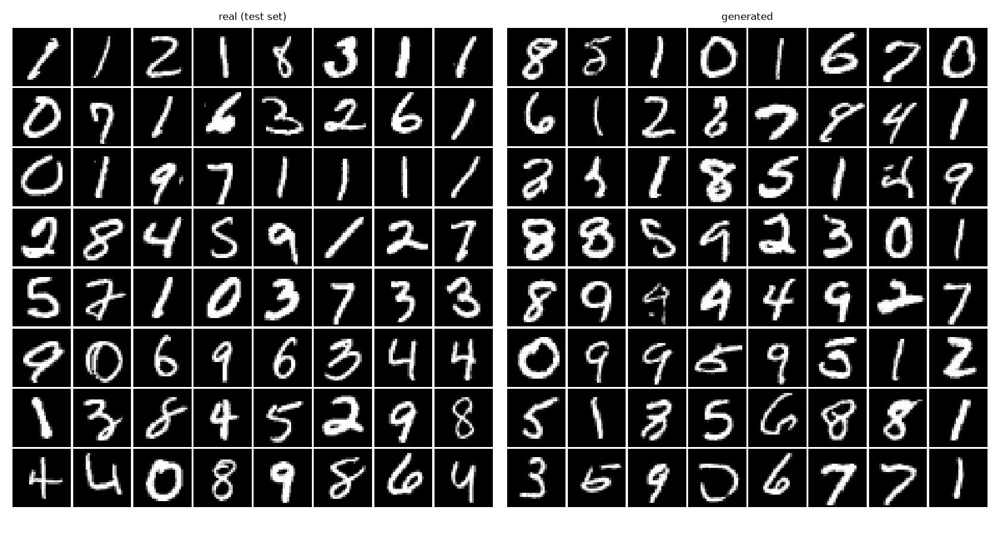

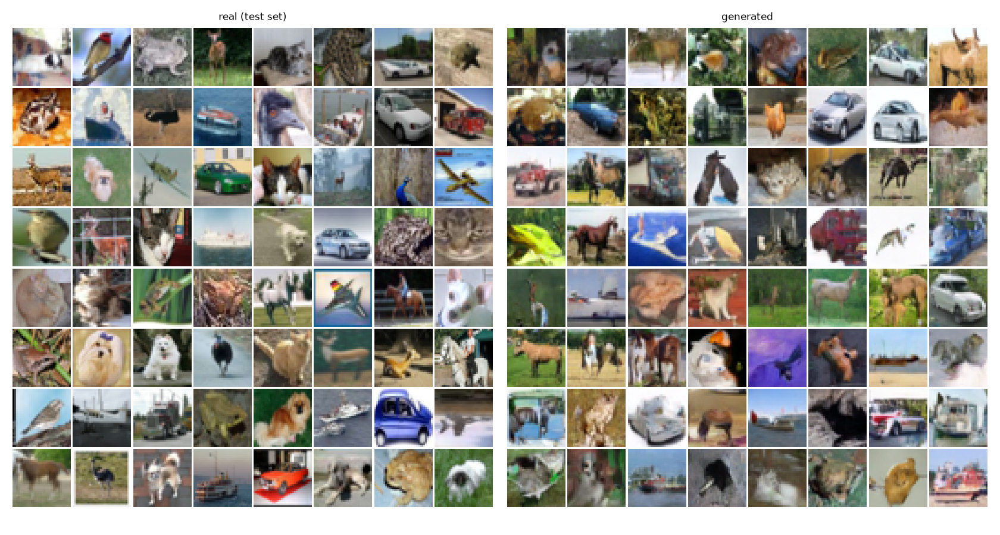

**Input → output at different noise levels.** A real image is noised to step t and then denoised
back. At small t the model only removes noise, so the output is close to the input. At large t
almost nothing is left of the input, and the model *generates* a new image.

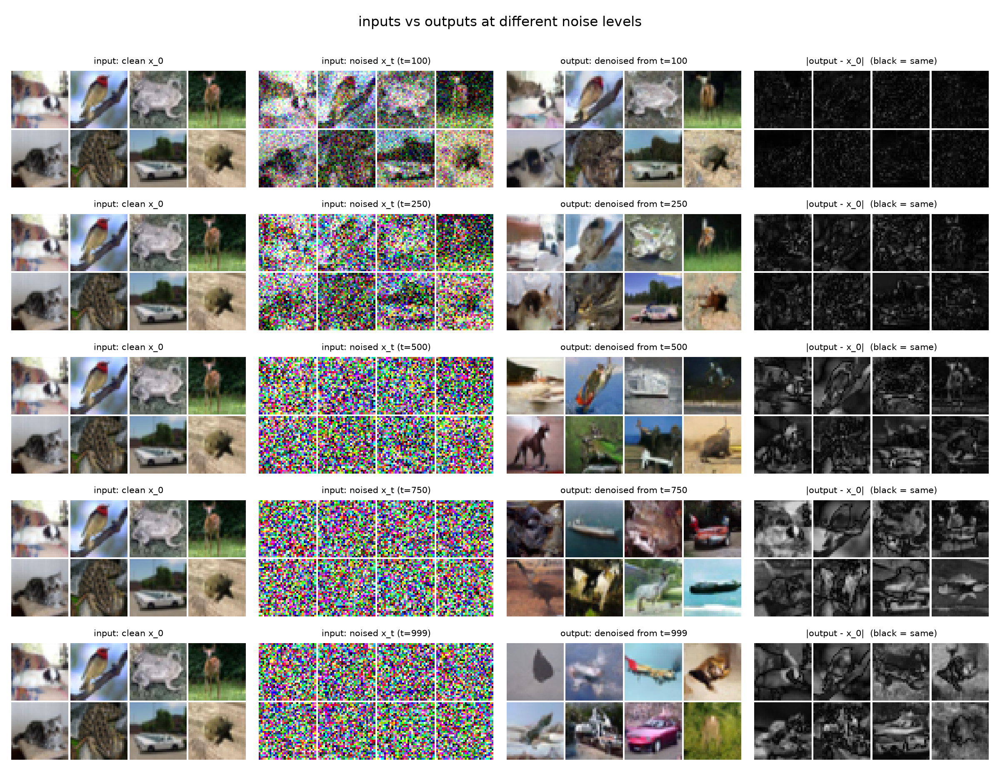

**What does the model "see" at each step?** The one-step guess of the clean image x̂₀ goes from a
blurry average (large t) to a sharp image (small t).

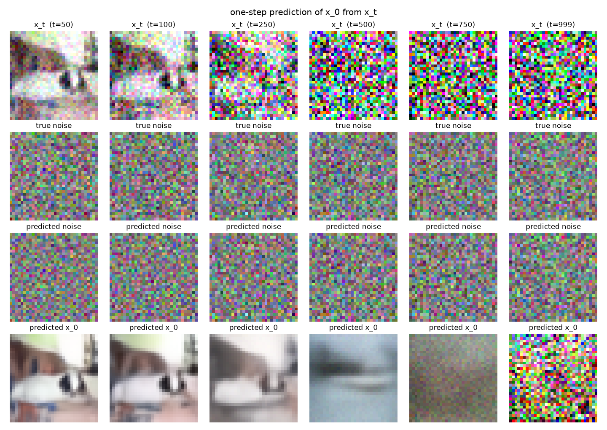

**When is the digit decided?** We noised MNIST test digits to step t, denoised them, and asked a
classifier whether the digit kept its identity.
- Up to t ≈ 300 the identity survives in **> 97 %** of cases.
- It drops to **53 % at t = 500** and **11 % at t = 750** (chance level).

So the *content* is decided in the middle of the chain, and the last ~300 steps only add detail.

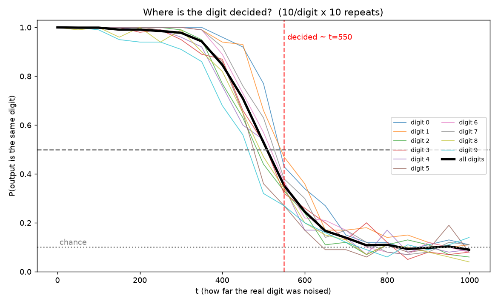

**Memorisation check.** We compared each generated image with its nearest training image.
Generated samples are about as far from the training set as real *test* images are (CIFAR-10 flow
model: 18.1 vs 18.4 average L2). The model makes new images instead of copying.

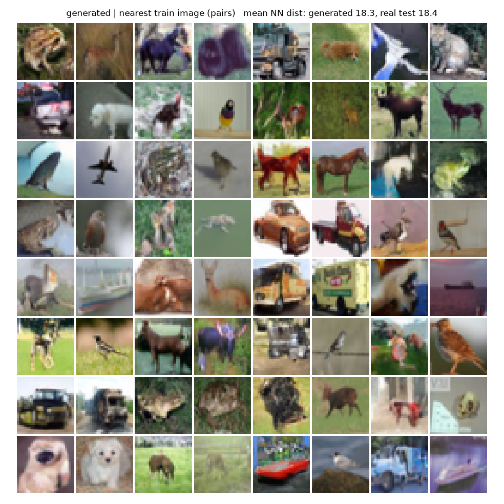

---

## Stage 2.1: Samplers (no retraining)

**Idea.** Training only teaches the network to predict noise. *How* we walk from noise to an image
is a separate choice, and it can be swapped on the already trained CIFAR-10 model.

The samplers we compare:
- **DDIM**, with η = 0 (deterministic) and η = 1 (stochastic).
- **Euler** and **Heun** on the probability-flow ODE.

We also checked numerically that Euler is *identical* to DDIM(η = 0): max difference about 1e-3.

| Sampler | 10 steps | 20 | 50 | 100 | 250 | 1000 |
|---|---:|---:|---:|---:|---:|---:|
| DDIM η = 0 | **56.0** | **43.7** | 37.3 | 33.6 | 31.5 | 29.9 |
| DDIM η = 1 | 76.0 | 54.6 | 40.7 | 35.2 | 30.1 | **26.5** |
| Heun (NFE ≈ 2×steps) | 92.5 | 45.2 | **27.1** | 28.4 | 29.4 | – |

- **Few steps:** deterministic DDIM is best.
- **About 100 model calls:** Heun (2nd order) is best, with FID 27.
- **Many steps:** stochastic sampling wins, because the injected noise corrects accumulated errors.

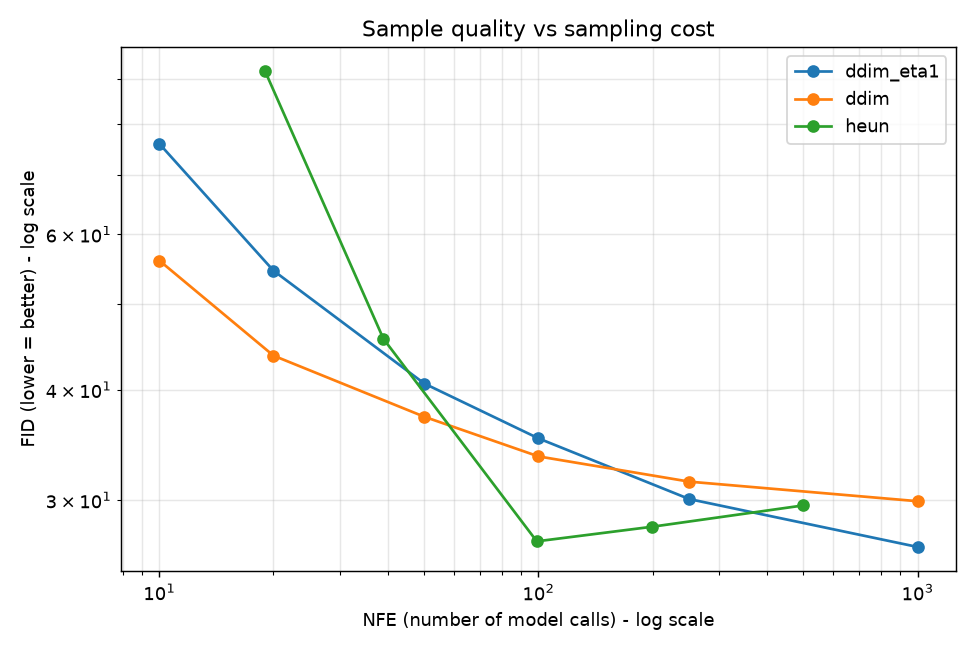

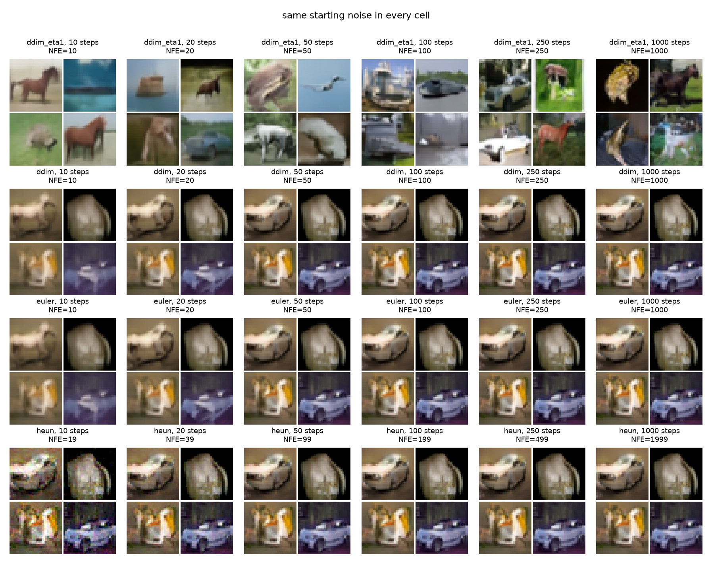

*The same starting noise in every cell. Deterministic samplers converge to the same image.*

---

## Stage 2.2: Class conditioning and classifier-free guidance (CFG)

**Setup.**
- The U-Net gets a class embedding. During training the label is replaced by a "null" class 10 % of the time.
- At sampling time: `ε = ε_uncond + w · (ε_cond − ε_uncond)`.

| w | 0 | 1 | 1.5 | 2 | 3 | 4 | 6 |
|---|---:|---:|---:|---:|---:|---:|---:|
| CIFAR-10 FID | 35.7 | 28.8 | 23.6 | **21.8** | 24.8 | 29.5 | 39.6 |
| CIFAR-10 diversity | 0.295 | 0.275 | 0.260 | 0.251 | 0.237 | 0.228 | 0.220 |
| MNIST FID | 8.2 | **5.1** | 5.3 | 6.9 | 10.9 | 16.9 | 28.8 |

Guidance trades **diversity for fidelity**. A moderate w (2 for CIFAR-10, 1 for MNIST) gives the best
FID. Larger w makes every sample look "prototypical" and over-saturated.

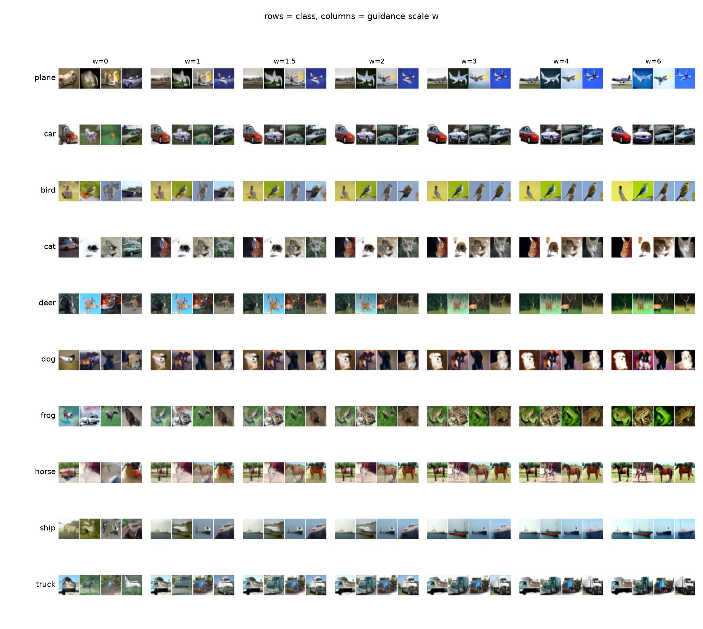

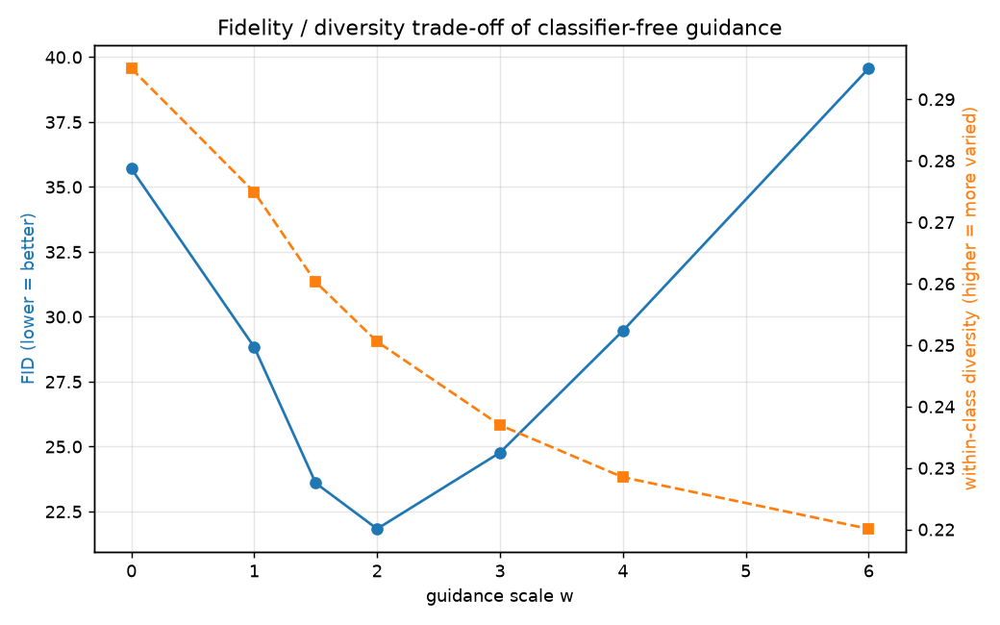

**Relabel test.** The *same* noised digit is denoised with every possible label. From moderate noise
the label decides which digit comes out. From small noise the original digit stays.

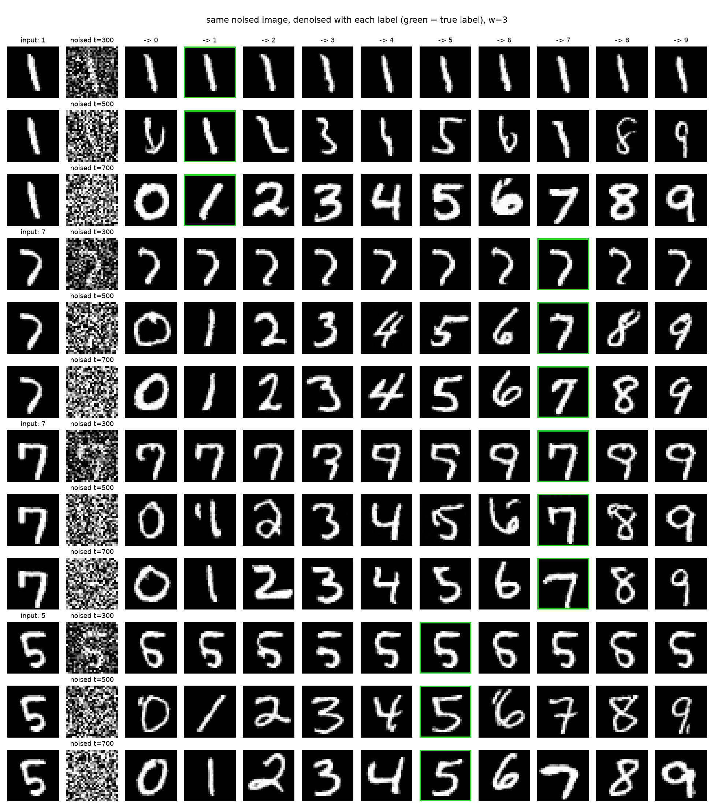

---

## Stage 2.3: Flow matching / rectified flow

**Idea.**
- Use a straight line between data and noise: `x_s = (1 − s)·x₀ + s·z`.
- The network predicts the velocity `z − x₀`.
- Sampling is plain Euler integration of that velocity.

Same networks as before, only a new training target.

| Dataset | FID | FID vs Euler steps (5 / 10 / 20 / 50 / 100) |
|---|---:|---|
| MNIST | 4.94 | 13.1 / 7.1 / 5.5 / 5.0 / 4.9 |
| CIFAR-10 | 25.5 | 60.8 / 39.1 / 32.4 / 28.3 / 25.9 |

Flow matching reaches DDPM quality (CIFAR-10 FID 25.5 vs 23.9) with **100 instead of 1000 steps**.

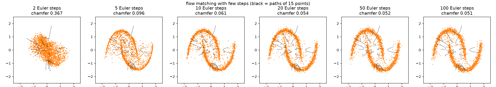

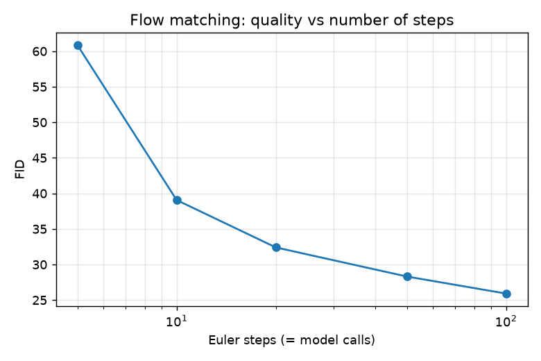


---

## Stage 3.1: Latent diffusion on CelebA 128×128

**Idea.** Don't diffuse 3×128×128 pixels. Instead:
1. Compress every face with the pretrained Stable Diffusion VAE into a **4×16×16 latent**, a 48× smaller tensor.
2. Train the flow model there.
3. Decode at the end.

**The VAE.**
- Reconstruction: **28.2 dB PSNR**.
- Latent statistics after scaling by 0.18215: mean 0.06, std 0.90, so close to N(0, 1).
- FID of the reconstructions alone is **6.9**. This is the best a latent model can ever reach.


| Model | Space | Steps trained | FID @ 100 Euler steps |
|---|---|---:|---:|
| U-Net (same training time) | pixels 3×128×128 | 10k | 36.9 |
| U-Net | latents 4×16×16 | 100k | **12.5** |
| *VAE reconstruction (ceiling)* | | | *6.9* |

**Pixel space** (70 min of training):

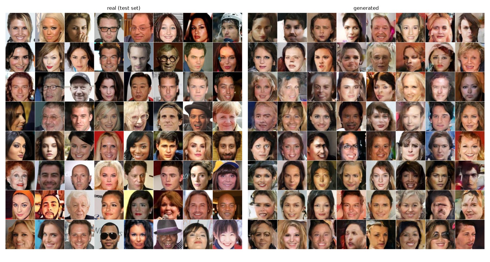

**Latent space:**


**No memorisation.** The generated faces are as far from their nearest training face as real test
faces are.

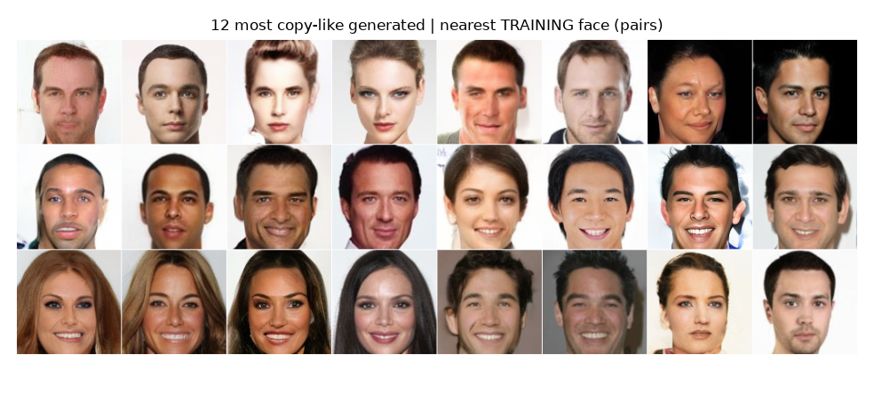

---

## Stage 3.2: Diffusion Transformer (DiT)

**Idea.** Replace the U-Net with a transformer working on the same latents:
1. **Patchify** the 4×16×16 latent: patch 2 gives 64 tokens, patch 4 gives 16 tokens.
2. Add 2D sin-cos position embeddings.
3. Run 8 transformer blocks with **adaLN-Zero** conditioning on time.
4. **Unpatchify** back to a latent.

The model has about 22M parameters, the same as the latent U-Net.

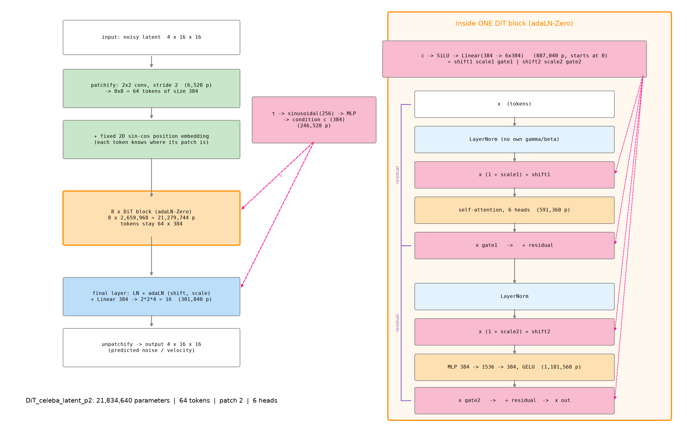

| Model | Tokens | Train time | FID @ 10 / 20 / 50 / 100 steps |
|---|---:|---:|---|
| Latent U-Net | – | 53 min | 22.0 / 15.5 / 13.2 / **12.5** |
| DiT-S/2 | 64 | 39 min | 22.2 / 16.0 / 13.7 / **13.0** |
| DiT-S/4 | 16 | 28 min | 28.3 / 22.2 / 19.7 / 19.1 |

- **DiT-S/2 matches the U-Net and trains faster.**
- Bigger patches (S/4) are cheaper but lose detail, because each token has to describe a 4×4
  region on its own.

**DiT-S/2:**


**DiT-S/4:**

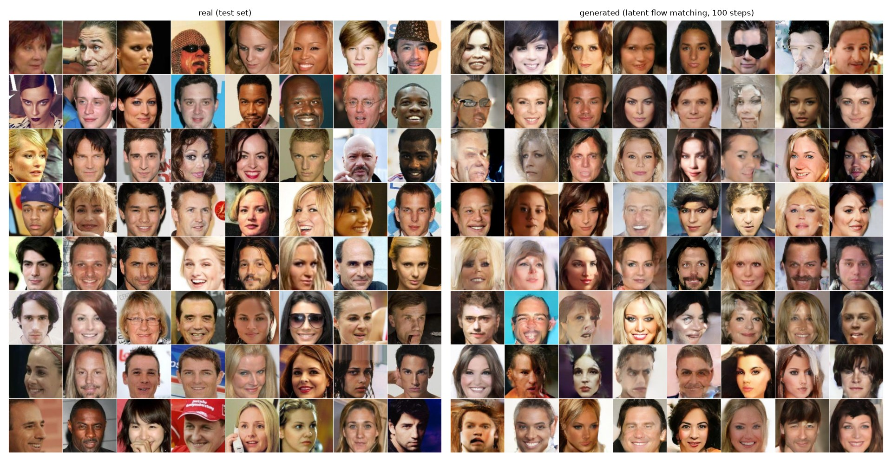

---

## Stage 3.3: Taking apart Stable Diffusion 1.5

**Idea.** Load the four parts of SD 1.5 separately and replace everything around them with our own
code from the earlier stages.
- The four parts: CLIP tokenizer, CLIP text encoder (123M), U-Net (860M), VAE (84M).
- Our code: the noise schedule, the samplers, CFG, img2img, inpainting and LoRA.

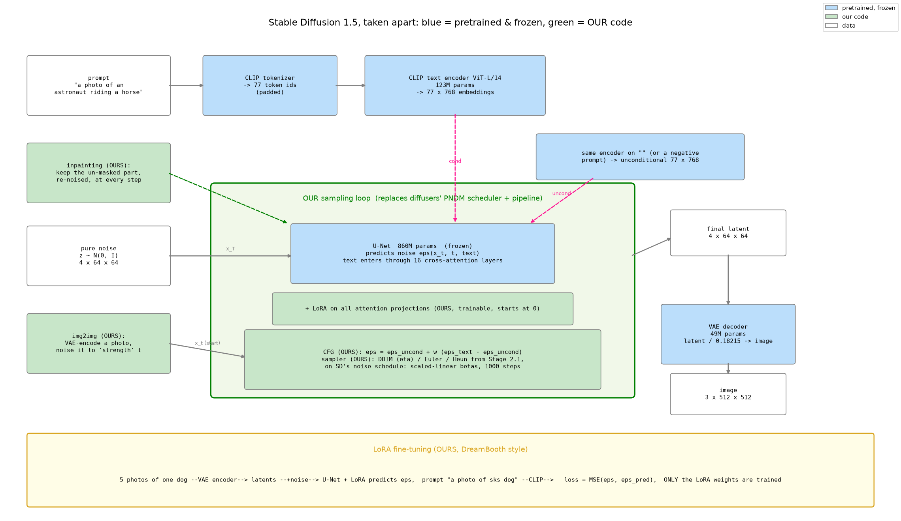

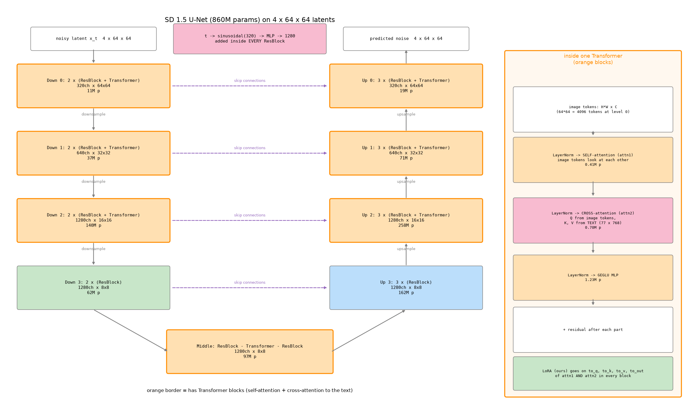

**Check against diffusers.** Our DDIM loop matches diffusers' `DDIMScheduler`. The noise schedules
are identical (to about 5e-7). The remaining 1 % latent difference comes from fp16 numerics.

**Speed:** **1.4 s per 512×512 image** (30 DDIM steps + CFG, fp16, 3/7 of an A100).

**Guidance sweep.** w = 1 (no guidance) ignores much of the prompt. w ≈ 5–10 follows it well. Very
large w over-saturates. This is the same trade-off as in Stage 2.2.

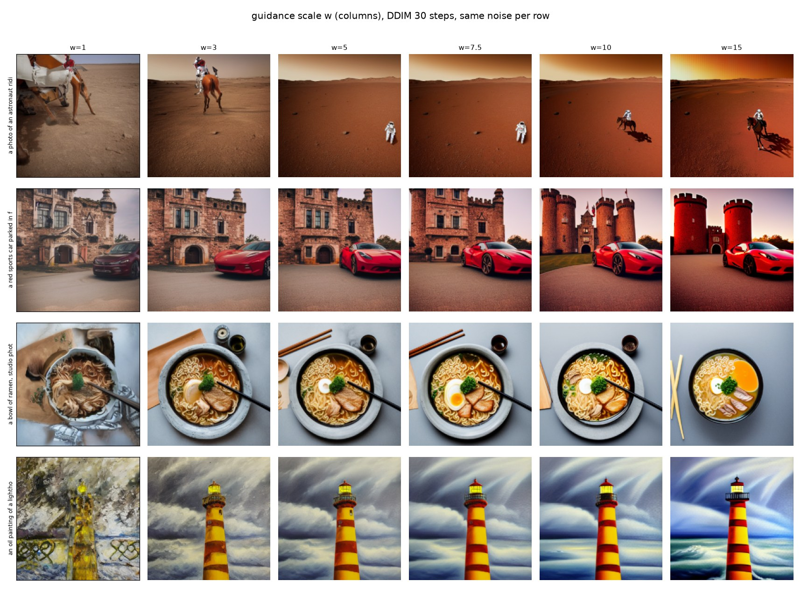

**Our Stage 2.1 samplers driving SD.**

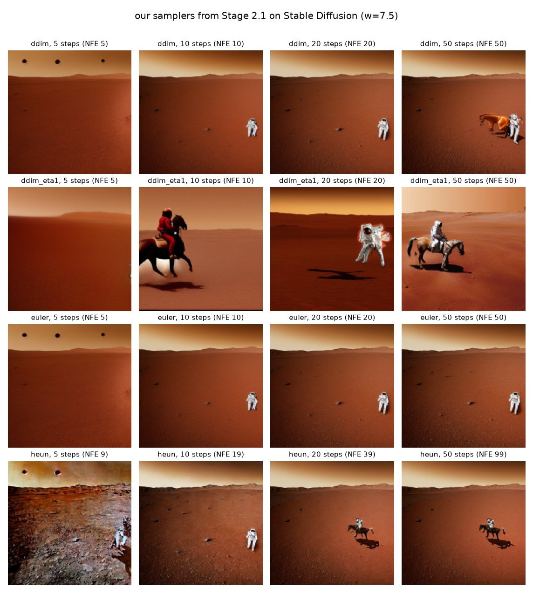

**What the model predicts along the way.** x̂₀ at different steps: the layout appears early, the
details late.

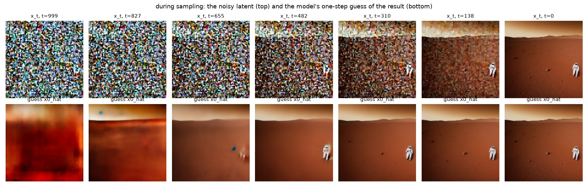

**Negative prompt.** The unconditional branch of CFG is replaced by a prompt to move *away* from.

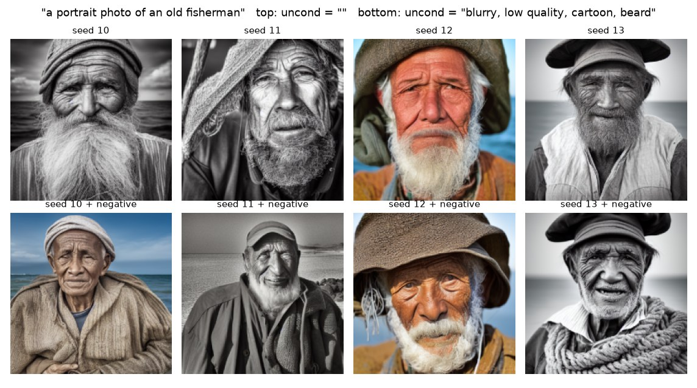

**img2img.** Encode an image, noise it to a "strength" t, and denoise it with a new prompt. Low
strength keeps the structure, high strength gives a new image.

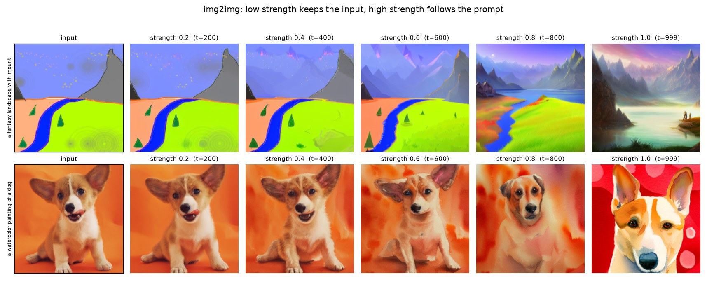

**Inpainting (blended).** At every step, the unmasked region is replaced by the original image
re-noised to that step, so only the masked region is generated.

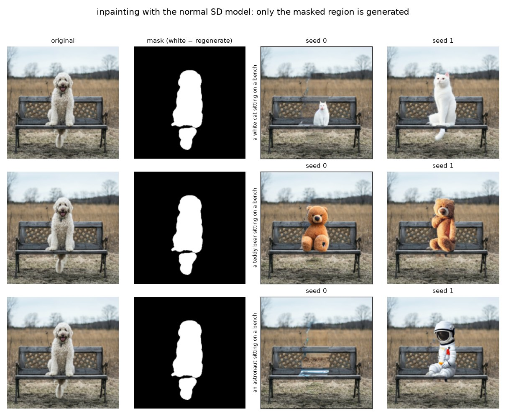

### LoRA / DreamBooth on 5 photos of one dog

**Setup.**
- LoRA (rank 8, **1.6M** trainable parameters, 0.2 % of the U-Net) on all attention projections.
- Data: the 5 photos of the DreamBooth example corgi, captioned "a photo of **sks** dog".
- Snapshots during training, all from the same seed.

**Without prior preservation.**
- The subject is learned in about 200 steps.
- Then the model **overfits**: prompts are ignored and the orange training background appears everywhere.
- **Language drift:** "a photo of a dog" turns into this corgi.

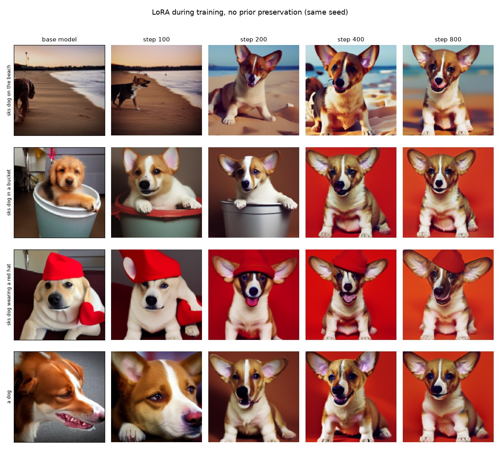

**With prior preservation.** 100 images of "a photo of a dog" are generated by the base model and
trained on alongside the corgi photos.
- "a dog" stays a generic dog, so there is no drift.
- The bucket and hat prompts keep working.
- The cost is slower learning of the subject (about 800 steps).

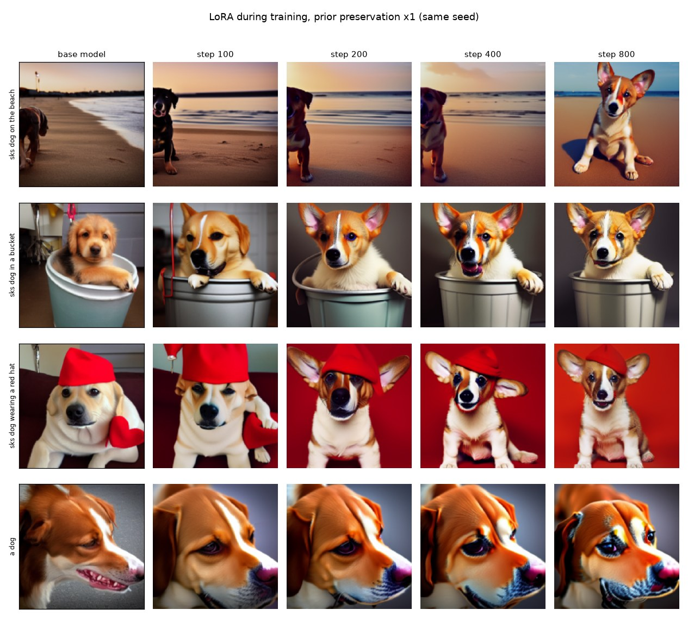

---

## Stage 4.1: Fast sampling by progressive distillation

**Idea** (Salimans & Ho, 2022).
- A *student* (a copy of the teacher, **same size**) learns to do in **1 step** what the teacher
  does in **2 DDIM steps**.
- It then becomes the next teacher: 512 → 256 → … → 2 → 1 steps.
- Only the number of steps shrinks, not the network.

**Setup.**
- Teacher: the Stage 1.2 CIFAR-10 model.
- **Round 0** fine-tunes it from ε-prediction to **v-prediction**. ε-prediction is unstable when one
  step has to jump straight from pure noise to an image.
- Then 9 halving rounds of 10k steps each, about 3 h on 3/7 of an A100.

| Steps | Original teacher (DDIM) | v-teacher (DDIM) | **Distilled student** |
|---:|---:|---:|---:|
| 512 | 30.4 | 27.8 | 27.8 |
| 64 | 35.6 | 31.0 | **27.9** |
| 16 | 46.4 | 37.4 | **27.9** |
| 8 | 63.4 | 48.8 | **27.9** |
| 4 | 125.2 | 89.0 | **29.1** |
| 2 | 325.7 | 207.7 | **32.7** |
| 1 | 328.2 | 419.5 | **35.0** |

- **8 steps = 512-step quality (64× faster).**
- **4 steps lose only 1.3 FID**, where plain DDIM at 4 steps is a blurry mess.
- **A single step gives FID 35**, better than the original teacher at 32 steps.

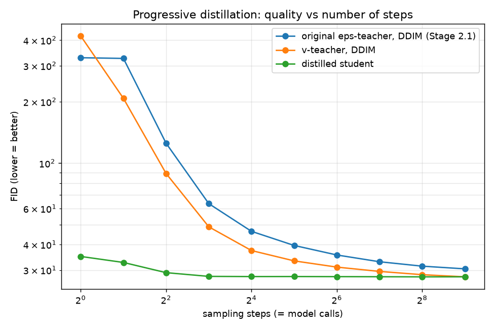

**Same starting noise.** The teacher (top) blurs into grey as steps are removed. The student
(bottom) produces **the same image at every step count**, because it learned the teacher's exact
noise → image mapping.

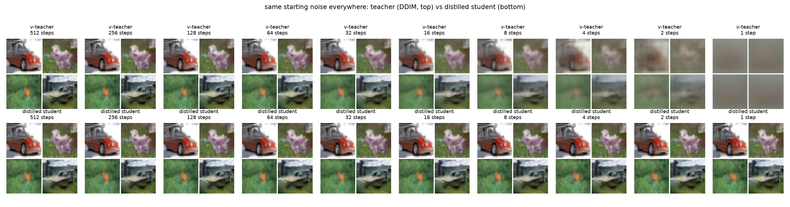

**Test-set comparison.** CIFAR-10 *test* images are noised to u = 250 / 500 / 750 / 1000 and then
denoised by the 512-step teacher and by the 16 / 8 / 4 / 2 / 1-step students.
- **The 16/8/4-step students give the same output as the teacher** (MSE to the teacher ≈ 0.000),
  with 4–128× fewer steps.
- At u ≥ 750 almost no signal is left, so all models generate the *same new* image.
- **The 1- and 2-step students fail when started at u = 250.** They were only trained on jumps from
  500 and 1000. A distilled student only works on its own time grid.

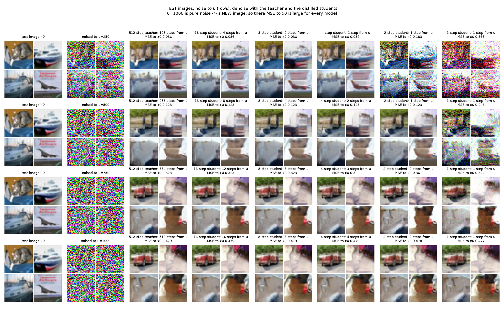

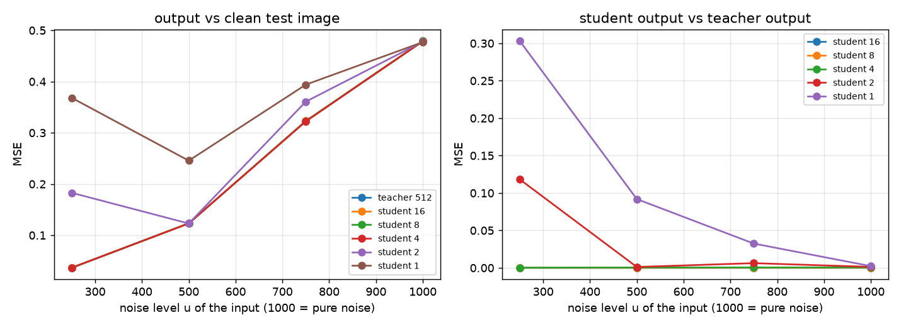

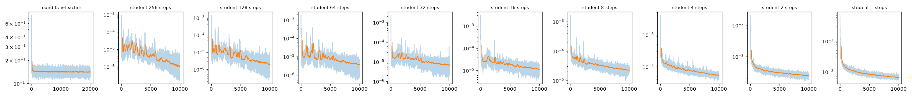

---

## Key takeaways

1. **The diffusion recipe is simple:** add noise, learn to predict it, remove it. The same MSE loss
   works from 2D points to 512×512 text-to-image.
2. **Training and sampling are separate.** One trained model can be sampled with DDPM, DDIM, Euler,
   Heun, or a distilled few-step sampler.
3. **Guidance trades diversity for fidelity.** There is a sweet spot (w ≈ 2 on CIFAR-10, ≈ 7.5 for SD).
4. **Straight paths are faster.** Flow matching reaches DDPM quality with 10× fewer steps.
5. **Latent space is the biggest win for high resolution.** CelebA FID 36.9 → 12.5. The VAE sets the
   ceiling (6.9).
6. **Transformers work as well as U-Nets on latents.** Patch size is the quality/compute knob.
7. **Fine-tuning on tiny data overfits quickly.** Prior preservation prevents language drift.
8. **Distillation turns 512 steps into 4–8** with almost no quality loss.

---

## Reproducing

```bash
bash prepare.sh                                     # once, on the login node (needs internet)
sbatch train.sh ddpm_images_Sg1_2.py --dataset cifar10        # train + test in one job
sbatch test.sh  samplers_Sg2_1.py --ckpt_run <run>            # test only
```

Every command for every experiment is in [notes.txt](notes.txt). The run names are
`<stage>_<method>_<model>_<dataset>[_<tag>]_<time>`.

## Project layout

- `*_Sg<stage>.py`: one script per project (modes `train`, `test`, `all`, and extras).
- `library/`: shared code:
  - `ddpm.py`, `flow.py`: training objectives.
  - `samplers.py`: DDIM, Euler, Heun.
  - `models.py`: MLP, U-Net, DiT.
  - `guidance.py`: CFG.
  - `vae.py`, `sd.py`: latent diffusion and Stable Diffusion.
  - `lora.py`: LoRA.
  - `distill.py`: progressive distillation.
  - `fid.py`: FID.
  - `viz_arch.py`, `viz_sd.py`: architecture diagrams.
- `viz/`: architecture diagrams. They are regenerated automatically when `models.py` changes.
- `report/figures/`: the figures used in this README.
- `outputs/<run>/`: all plots and `results.json` of each run (not tracked by git).
- `checkpoints/`, `logs/`: model weights and Slurm logs (not tracked).
- `train.sh` / `test.sh`: Slurm scripts for the Grete GPUs. `prepare.sh`: environment and downloads.
