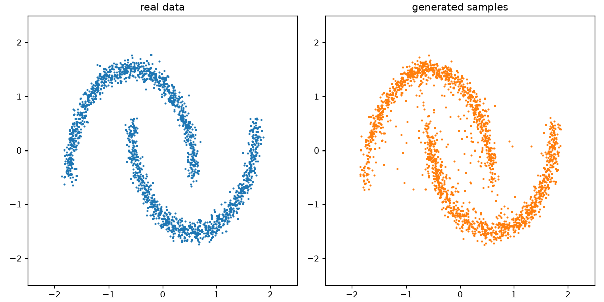
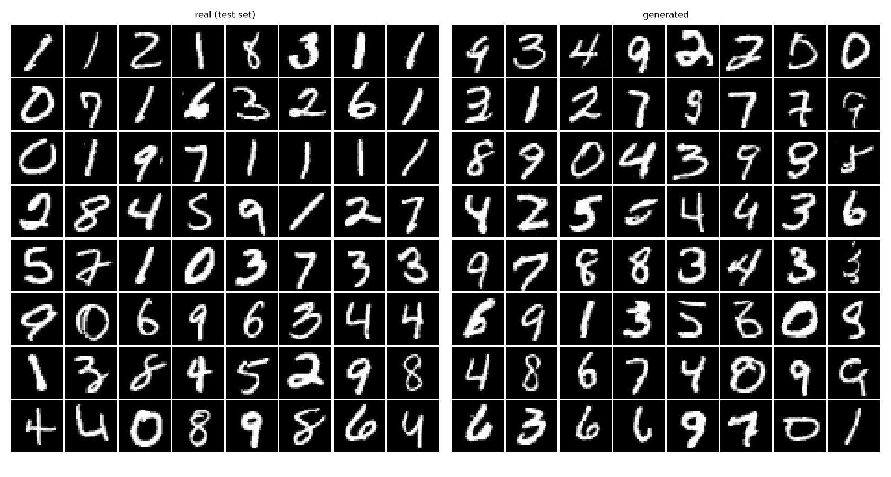
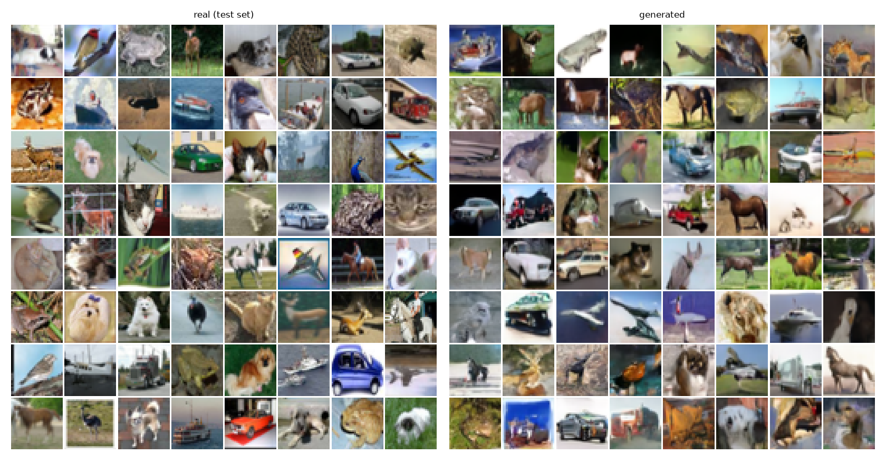
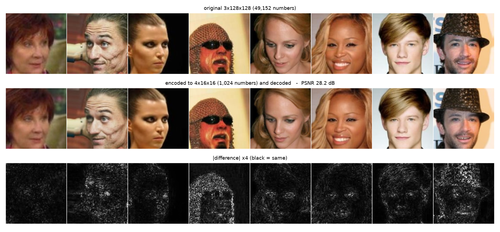
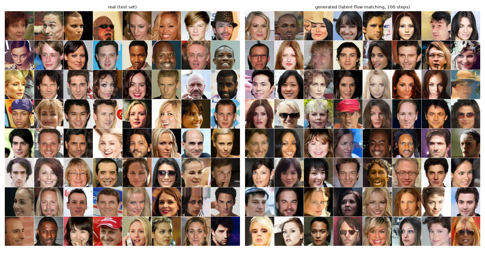
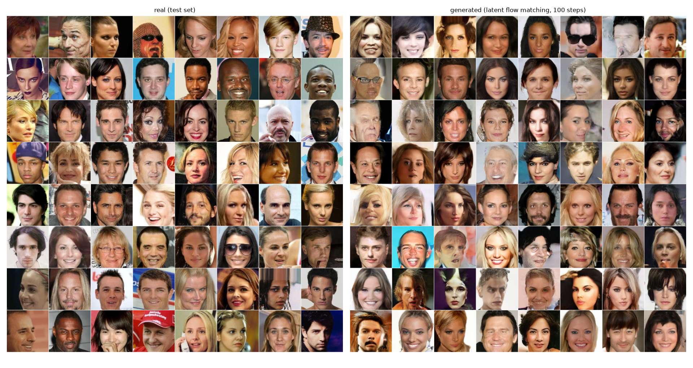
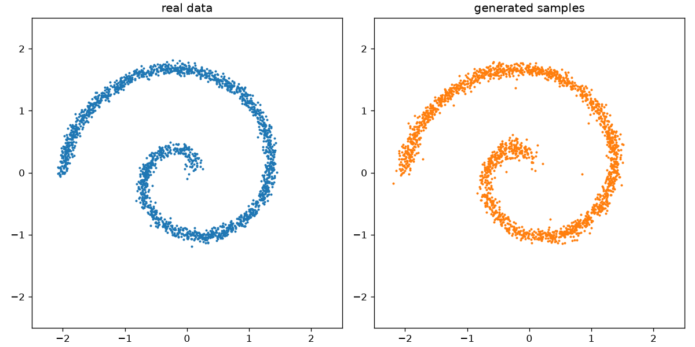
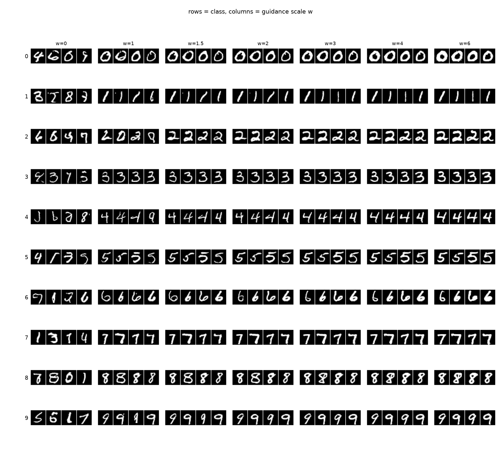

# Diffusion Learning Projects

Small hands-on projects for learning diffusion models with PyTorch.

The project includes:

- DDPMs on 2D datasets such as spirals and two moons
- DDPMs on MNIST and CIFAR-10 images
- DDIM, Euler, and Heun samplers
- Class conditioning and classifier-free guidance
- Flow matching on 2D data, MNIST, and CIFAR-10
- VAE reconstruction and latent-space checks

## Latest results

The most recent experiments compare flow matching with the earlier DDPM
experiments and begin the move toward latent diffusion.

### Flow matching

An MLP flow-matching model was trained on both spiral and two-moons data. With
100 Euler steps, the final Chamfer distance was **0.0380** for the spiral and
**0.0508** for the two-moons dataset. The distance decreases substantially as
the number of sampling steps increases, showing the effect of ODE solver
resolution.



Flow matching was also tested with U-Nets on image datasets:

| Dataset | Training steps | FID |
| --- | ---: | ---: |
| MNIST | 20,000 | **4.94** |
| CIFAR-10 | 100,000 | **25.53** |

For the CIFAR-10 flow-matching model, the Euler sampler reached an FID of
**25.91** with 100 steps, compared with **60.84** with only 5 steps.





### VAE reconstruction check

The first latent-diffusion preparation experiment evaluated a pretrained
Stable Diffusion VAE on CelebA face images. Images were encoded from
`3 x 128 x 128` pixels to `4 x 16 x 16` latent representations and decoded
again. The reconstruction achieved **28.2 dB PSNR**, with latent mean **0.061**
and standard deviation **0.900**.



### Latest latent diffusion progress

The project has now moved from pixel-space models to latent flow matching on
CelebA. Images are encoded with the VAE into `4 x 16 x 16` latent tensors, and
the flow model is trained in that smaller representation.

| Model | Training steps | FID at 100 Euler steps |
| --- | ---: | ---: |
| Pixel-space U-Net baseline | 10,275 | 36.88 |
| Latent U-Net | 100,000 | **12.48** |
| Latent DiT, patch size 2 | 100,000 | **13.03** |
| Latent DiT, patch size 4 | 100,000 | 19.09 |

The latent U-Net currently gives the best CelebA result. The patch-2 DiT is
close behind, while the patch-4 DiT shows the trade-off between fewer tokens
and generation quality. For the patch-2 DiT, FID improved from **22.20** at
10 Euler steps to **13.03** at 100 steps.





## Experiments completed so far

### 1. DDPM on 2D toy data

An MLP-based DDPM was trained on a spiral dataset. The model learns the
distribution and generates samples with a similar spiral shape. The run also
includes reverse-process visualizations, denoising trajectories, and a learned
vector field.



### 2. DDPM on MNIST

A small U-Net was trained to generate handwritten digits. The output below
compares real test images with generated samples. Additional experiments
inspect the reverse diffusion process and the similarity between generated and
training images.


### 3. DDPM on CIFAR-10

The same diffusion workflow was applied to CIFAR-10 using a U-Net. The images
are more difficult to generate than MNIST because they contain natural-image
textures and multiple object classes, but the run produces recognizable
low-resolution samples and FID evaluation outputs.


### 4. Classifier-free guidance

Class-conditional MNIST generation was implemented by randomly dropping labels
during training and changing the guidance scale during sampling. The grid
below shows how samples change as the guidance scale `w` increases.



### 5. Alternative samplers

DDIM, Euler, and Heun samplers were tested on trained CIFAR-10 models. Their
results are saved in `outputs/Samplers_*`, including comparisons of FID against
the number of function evaluations and grids generated from the same initial
noise.

## Setup

On a machine with internet access, run:

```bash
bash prepare.sh
```

This creates the Python environment, installs the dependencies, and downloads
the datasets and FID model weights.

## Usage

Activate the environment:

```bash
source venv/bin/activate
```

Run a small 2D experiment locally:

```bash
python ddpm_2d_Sg1_1.py --mode all --dataset spiral
```

For GPU/Slurm runs, use the provided scripts:

```bash
sbatch train.sh ddpm_images_Sg1_2.py --dataset mnist
sbatch train.sh ddpm_images_Sg1_2.py --dataset cifar10
```

See [notes.txt](notes.txt) for more experiment commands and options.

## Project layout

- `ddpm_2d_Sg1_1.py` - DDPM on 2D toy data
- `ddpm_images_Sg1_2.py` - DDPM on image datasets
- `samplers_Sg2_1.py` - alternative sampling methods
- `cfg_Sg2_2.py` - classifier-free guidance
- `library/` - reusable models, data loaders, samplers, and utilities
- `checkpoints/` - saved model checkpoints
- `outputs/` - experiment results
